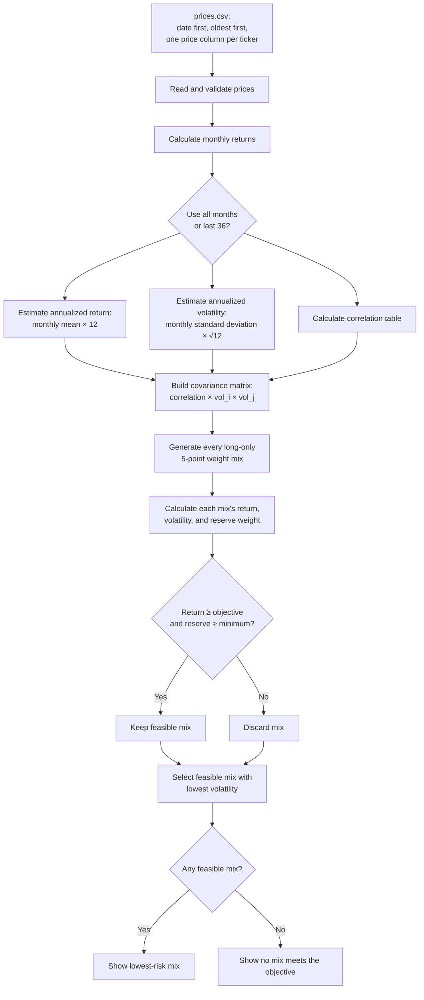

# Project 2 fund universe and price sources

## Selected funds

| Ticker | Fund name | Portfolio role |
| --- | --- | --- |
| SGOV | iShares 0-3 Month Treasury Bond ETF | Cash and reserve |
| IEI | iShares 3-7 Year Treasury Bond ETF | Government bonds |
| SPIB | SPDR Portfolio Intermediate Term Corporate Bond ETF | Investment-grade fixed income |
| IVV | iShares Core S&P 500 ETF | Broad U.S. equity |

## Price-data record

The file `prices.csv` contains monthly **Adjusted Close** prices, with the date first and observations ordered oldest to newest. The source is Yahoo Finance Historical Data, Monthly frequency; the adjusted-close field incorporates distributions and splits.

| Ticker | Source | Download date |
| --- | --- | --- |
| SGOV | [Yahoo Finance historical data](https://finance.yahoo.com/quote/SGOV/history/) | 2026-10-22 |
| IEI | [Yahoo Finance historical data](https://finance.yahoo.com/quote/IEI/history/) | 2026-10-22 |
| SPIB | [Yahoo Finance historical data](https://finance.yahoo.com/quote/SPIB/history/) | 2026-10-22 |
| IVV | [Yahoo Finance historical data](https://finance.yahoo.com/quote/IVV/history/) | 2026-10-22 |

The downloaded window is October 2021 through September 2026: 60 completed monthly observations. Historical average returns calculated from these prices are estimates, not forecasts.

## Portfolio-engine flow

